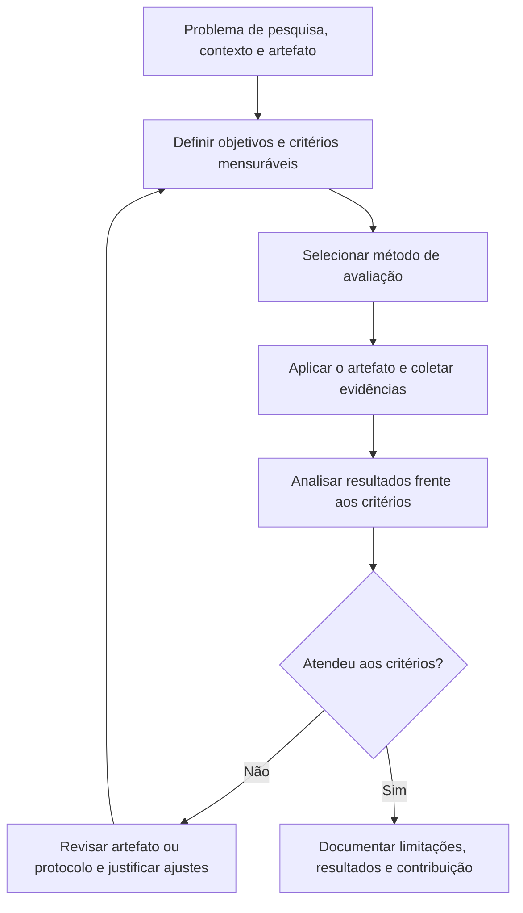
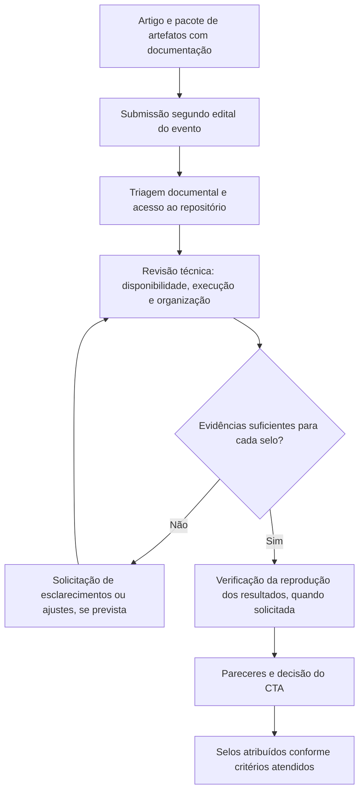
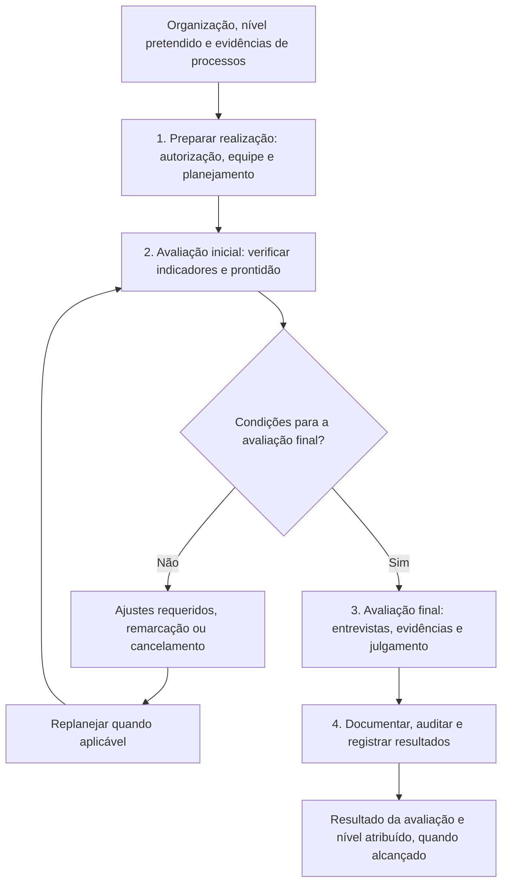

# Tarefa 6 — Comparação de três abordagens de avaliação de artefatos utilizadas no Brasil

**Universidade Federal do Pampa (UNIPAMPA) — Campus Alegrete**  
**Discente:** Fernando Henrique de Souza Marques  
**Curso:** Mestrado em Engenharia de Software  
**Componente curricular:** Laboratório de Engenharia de Artefatos de Software  
**Data da revisão:** 30 de outubro de 2026

## 1. Introdução

A avaliação de artefatos permite verificar, sob critérios explícitos, as propriedades e os resultados de soluções computacionais, tais como algoritmos, protótipos, modelos, conjuntos de dados e sistemas. Entretanto, a expressão **avaliação de artefatos** não designa um único processo: o objeto, as evidências, os procedimentos e as decisões variam conforme o contexto científico ou organizacional.

Este trabalho compara três abordagens aplicadas no Brasil: **(1)** avaliação de artefatos no contexto de *Design Science Research* (DSR), apresentada por Pimentel, Filippo e Santoro (2020); **(2)** avaliação técnica de artefatos em eventos brasileiros organizados pela comunidade da Sociedade Brasileira de Computação (SBC), exemplificada por regras do SBSeg e resultados do SBRC; e **(3)** avaliação de processos de software pelo **MA-MPS**, método do programa MPS.BR, conforme o Guia de Avaliação da Softex (2024).

**Delimitação metodológica.** Trata-se de uma **análise documental e comparativa**, não de uma avaliação experimental de artefatos reais. Os fluxogramas são **sínteses didáticas elaboradas a partir das fontes**, não reproduções literais dos fluxos publicados. A DSR é uma abordagem de pesquisa internacional discutida aqui a partir de literatura brasileira; a SBC não possui necessariamente um procedimento único e idêntico para todos os seus eventos; e o MA-MPS avalia **processos organizacionais**, utilizando artefatos como evidências — não certifica isoladamente a qualidade de um código.

## 2. Descrição dos processos e fluxogramas (item A)

### 2.1. Avaliação de artefatos em Design Science Research (DSR)

**Fonte-base:** Pimentel, Filippo e Santoro (2020).

A DSR procura desenvolver e investigar artefatos capazes de solucionar problemas relevantes e produzir conhecimento justificável. A avaliação não é apenas um teste de execução: compara **critérios previamente definidos** com evidências de utilidade, adequação e desempenho no contexto estudado. É possível empregar experimentos, simulações, estudos de caso, testes com usuários e outras estratégias, de acordo com a pergunta de pesquisa.

**Entradas:** artefato/protótipo, definição do problema, contexto de aplicação, hipóteses ou objetivos e critérios de sucesso. **Etapas:** planejamento da avaliação; escolha do método; aplicação e coleta; análise e, quando cabível, refinamento. **Saídas:** evidências documentadas sobre o desempenho e a utilidade do artefato, interpretação dos resultados, limitações e contribuição científica. **Observação:** uma avaliação favorável não implica que o artefato funcione em todos os contextos; a validade depende do desenho e das condições do estudo.

### 2.2. Avaliação de artefatos em eventos brasileiros da SBC (SBSeg/SBRC)

**Fontes-base:** instruções oficiais de avaliação de artefatos do SBSeg 2024; resultados do Comitê Técnico de Artefatos (CTA) do SBRC 2026.

Nesse contexto, o foco está na **disponibilização e na verificabilidade** dos recursos que sustentam trabalhos científicos. Dependendo do edital do evento, os autores submetem repositório, README, instruções técnicas, dados, scripts, apêndice de avaliação e evidências relacionadas ao artigo. O CTA verifica as dimensões previstas no regulamento aplicável. A existência de um DOI pode reforçar a preservação, mas **não é requisito universal** para todos os selos e todos os eventos.

Os quatro selos descritos nas instruções brasileiras consultadas são: **D — Disponível** (acesso e documentação mínima), **F — Funcional** (capacidade de instalação e execução das funcionalidades), **S — Sustentável** (organização, legibilidade e documentação do artefato) e **R — Experimentos Reprodutíveis** (possibilidade de confirmar os principais resultados experimentais). O selo F não equivale, por si só, ao selo R.

**Entradas:** artigo associado, artefatos digitais, repositório acessível, README, dependências, procedimentos e, quando exigido, apêndice de avaliação. **Etapas:** submissão; verificação de acesso e documentação; avaliação da execução e sustentabilidade; reprodução dos experimentos, quando aplicável; deliberação do comitê. **Saídas:** parecer e eventual concessão individualizada dos selos D, F, S e R. **Observação:** a interação para correções, os prazos e a estrutura da avaliação variam por evento; não se deve atribuir automaticamente uma fase denominada *kick-the-tires* a todos os eventos da SBC.

### 2.3. Avaliação de processos organizacionais pelo MA-MPS (MPS.BR)

**Fonte-base:** Softex, *Guia de Avaliação:2024 — Parte I*.

O **MA-MPS** é o processo e método de avaliação do programa MPS.BR. No modelo de software (**MR-MPS-SW**), o foco está na capacidade e maturidade dos **processos de uma unidade organizacional**. Documentos, registros, produtos de trabalho e entrevistas constituem evidências utilizadas para verificar a implementação dos resultados exigidos. Os níveis de maturidade do MR-MPS-SW vão de **G a A**.

O guia oficial de 2024 estrutura a avaliação em quatro subprocessos: **preparar a realização da avaliação; realizar a avaliação inicial; realizar a avaliação final; documentar os resultados da avaliação**. A avaliação pode ser presencial, remota ou mista, conforme planejamento e condições do método.

**Entradas:** escopo e unidade organizacional, nível de maturidade pretendido, indicadores, artefatos e registros dos processos, participantes e plano de avaliação. **Etapas:** preparação; avaliação inicial; ajustes e preparação final, quando necessários; avaliação final; auditoria e registro dos resultados. **Saídas:** documentação e resultado oficial da avaliação, incluindo o nível de maturidade atingido quando os critérios são satisfeitos. **Observação:** a organização pode não alcançar o nível pretendido; o resultado não é uma certificação individual de todos os artefatos analisados.

## 3. Quadro comparativo e análise crítica (item B)

### 3.1. Quadro comparativo

| Dimensão | DSR — avaliação de artefatos | Avaliação de artefatos — SBC (exemplos SBSeg/SBRC) | MA-MPS — Softex |
|---|---|---|---|
| **Domínio** | Pesquisa científica e desenvolvimento de soluções | Publicação científica e ciência aberta | Engenharia de software e melhoria organizacional |
| **Unidade avaliada** | Artefato no contexto de um problema de pesquisa | Pacote de artefatos associado a artigo | Processos de uma unidade organizacional |
| **Exemplos de evidências** | Resultados de experimentos, testes e estudos de caso | Repositório, README, scripts, logs, dados e reprodução | Produtos de trabalho, indicadores, documentação e entrevistas |
| **Objetivo central** | Demonstrar utilidade, adequação e contribuição | Verificar disponibilidade, funcionamento, sustentabilidade e reprodutibilidade | Determinar atendimento ao modelo de referência e nível de maturidade |
| **Entradas** | Problema, artefato, critérios e ambiente | Artigo, artefatos, instruções e critérios do evento | Escopo, modelo MR-MPS, evidências e planejamento |
| **Procedimento** | Planejar, experimentar/observar, analisar e eventualmente refinar | Submeter, verificar, testar, reproduzir e deliberar, conforme edital | Preparar, avaliar inicialmente, avaliar finalmente e documentar |
| **Avaliadores** | Pesquisadores, especialistas e/ou usuários, conforme estudo | Membros do CTA/revisores técnicos do evento | Equipe de avaliação e avaliador líder habilitados |
| **Resultado** | Evidências e conclusões sobre o artefato | Parecer e selos D, F, S, R, quando atendidos | Resultado de avaliação e nível de maturidade, quando alcançado |
| **Ponto forte** | Flexibilidade metodológica e alinhamento com o problema | Transparência e possibilidade de escrutínio técnico | Critérios padronizados e visão sistêmica dos processos |
| **Limitação** | Resultados dependem da validade e do escopo do estudo | Esforço de revisão e dependência da documentação/ambiente | Exige recursos, coordenação e evidências organizacionais consistentes |
| **Tipo de julgamento** | Utilidade e evidência científica | Propriedades verificáveis do artefato submetido | Capacidade/maturidade dos processos organizacionais |

### 3.2. Semelhanças

Os três enfoques procuram **reduzir a subjetividade** por meio de critérios declarados e de evidências examináveis. Também promovem **rastreabilidade** entre o que é alegado e o que é demonstrado. Podem existir oportunidades de esclarecimento, correção ou refinamento, mas sua extensão varia; não é correto afirmar que todos garantem a mesma forma de iteração.

Em particular, a documentação é importante nos três contextos, porém com funções distintas. Na DSR, ela permite interpretar validade e contribuição; na avaliação de artefatos de eventos, facilita inspeção e execução independente; no MA-MPS, sustenta a comprovação da implementação de práticas organizacionais.

### 3.3. Diferenças e análise crítica

A diferença mais relevante está no **objeto do julgamento**. Na DSR, um artefato pode ser considerado útil para uma classe de problemas mesmo sem ter um pacote plenamente distribuível ou reproduzível por terceiros. Em eventos científicos, um software pode ser executável e obter o selo F sem que a reprodução dos resultados exigida para R tenha sido demonstrada. No MA-MPS, documentos e softwares funcionam como **indicadores da execução dos processos** e não como unidade exclusiva de certificação.

Há ainda diferenças na **finalidade**: a DSR prioriza a justificativa de uma contribuição científica e prática; o CTA de eventos busca elevar a transparência do trabalho publicado; o MA-MPS busca caracterizar a maturidade de práticas organizacionais. Por isso, uma comparação direta que reduza os três processos à pergunta “o código funciona?” seria metodologicamente inadequada.

Os enfoques são **complementares**, não intercambiáveis. Por exemplo, uma equipe pode empregar DSR para projetar um algoritmo, disponibilizar um pacote de reprodução para avaliação por um CTA e desenvolver o projeto em uma organização cujos processos sejam objeto de avaliação MPS.BR. Cada avaliação responderá a uma pergunta diferente e exigirá evidências próprias.

## 4. Considerações finais

A comparação evidencia que a avaliação de artefatos e de processos não possui um único significado técnico. A DSR avalia a adequação de uma solução a um problema de pesquisa; a avaliação técnica de artefatos em eventos da SBC examina características de pacotes científicos e a capacidade de verificação de resultados; o MA-MPS determina maturidade de processos organizacionais a partir de um conjunto mais amplo de evidências. Os três enfoques valorizam critérios explícitos e rastreabilidade, mas diferem no objeto, nos avaliadores, nas entradas e nos resultados.

A análise recomenda selecionar o processo conforme a **pergunta avaliativa**, evitando confundir selos de um artefato com avaliação da contribuição científica ou com níveis de maturidade de uma organização. Este trabalho constitui uma síntese documental e não permite afirmar conformidade de um artefato ou de uma organização real.

## Referências (organização conforme padrão acadêmico brasileiro)

PIMENTEL, Mariano; FILIPPO, Denise; SANTORO, Flávia Maria. **Design Science Research: fazendo pesquisas científicas rigorosas atreladas ao desenvolvimento de artefatos computacionais projetados para a educação**. In: JAQUES, Patrícia Augustin et al. (org.). *Metodologia de pesquisa em informática na educação: concepção da pesquisa*. Porto Alegre: Sociedade Brasileira de Computação, 2020. (Série Metodologia de Pesquisa em Informática na Educação, v. 1). Disponível em: https://metodologia.ceie-br.org/livro-1/. Acesso em: 30 out. 2026.

SOCIEDADE BRASILEIRA DE COMPUTAÇÃO (SBC). **Avaliação de Artefato do SBSeg 2024: instruções de submissão**. 2024. Disponível em: https://doc-artefatos.github.io/sbseg2024/subinstrucoes.html. Acesso em: 30 out. 2026.

SOCIEDADE BRASILEIRA DE COMPUTAÇÃO (SBC). **Avaliação de Artefato do SBRC 2026: resultados**. 2026. Disponível em: https://doc-artefatos.github.io/sbrc2026/results.html. Acesso em: 30 out. 2026.

SOFTEX. **MPS — Guia de Avaliação:2024. Parte I: Processo e Método de Avaliação MA-MPS**. Brasília, DF: Softex, 2024. Disponível em: https://softex.br/download/guia-de-avaliacao2024-parte-i/. Acesso em: 30 out. 2026.

---

*Nota editorial: os fluxogramas são interpretações sintéticas dos processos, construídas para fins didáticos. O uso de Mermaid permite visualizá-los diretamente na interface do GitHub.*