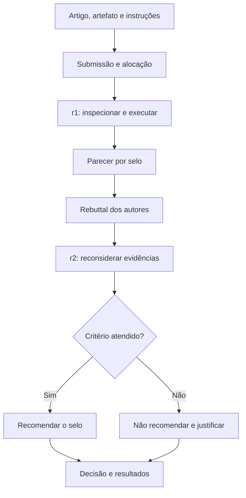
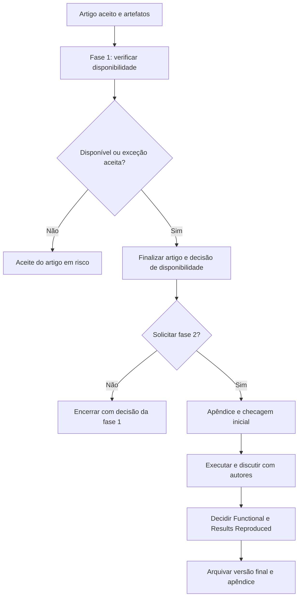
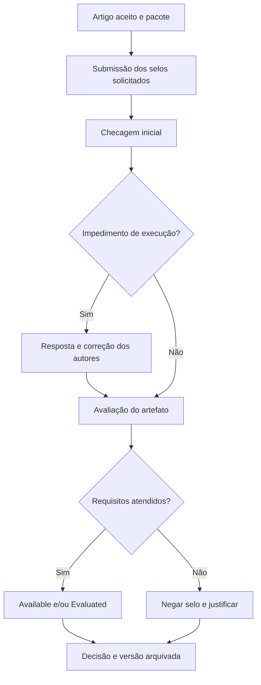

# Tarefa 6 — Comparação de três processos de avaliação de artefatos

Fernando Henrique de Souza Marques · Revisão de 05/11/2026

[Visualizar a apresentação web da Atividade 6](https://fernandomarquesaluno-svg.github.io/portfolio-artefatos-software/#atividade-6) — tabelas técnicas e fluxos resumidos, integrados ao portfólio acadêmico.

## Objetivo e método

Comparar **SBSeg 2026, USENIX Security 2025 e MODELS 2025**, a partir das instruções oficiais. Os três avaliam artefatos associados a trabalhos científicos. A comparação anterior incluía MA-MPS, cujo objeto é o processo organizacional, e uma descrição ampla de DSR. A seleção atual atende de modo mais direto ao enunciado.

Pesquisa documental assistida por ChatGPT/Codex (OpenAI), que auxiliou a localizar fontes, contrastar critérios e redigir os fluxogramas e a tabela. Consulta em 05/11/2026. Os fluxos são sínteses didáticas; as decisões administrativas seguem cada edital. Não foram conduzidas avaliações oficiais nesses eventos.

## 1. SBSeg 2026

Entrada: artigo, artefato, README e requisitos. A revisão r1 registra inspeção e execução; o rebuttal permite esclarecimentos; r2-decision decide cada selo. F exige prova de execução de funcionalidades; R exige reproduzir as principais reivindicações. D verifica acesso/documentação e S organização e inteligibilidade. Fonte: [instruções de revisão](https://doc-artefatos.github.io/sbseg2026/revinstrucoes.html).

## 2. USENIX Security 2025

A fase 1 verifica disponibilidade permanente antes da versão final do artigo, com exceções justificadas. GitHub sozinho não atende a essa preservação. A fase 2, opcional, avalia funcionamento e reprodução após a versão final. Inclui apêndice, checagem inicial, interação com autores, execução e decisão. Fontes: [chamada](https://www.usenix.org/conference/usenixsecurity25/call-for-artifacts), [submissão](https://secartifacts.github.io/usenixsec2025/instructions) e [guia do avaliador](https://secartifacts.github.io/usenixsec2025/guide).

Uma exceção de compartilhamento não equivale à concessão do selo de disponibilidade. A checagem inicial identifica impedimentos; a avaliação detalhada verifica os critérios solicitados.

## 3. MODELS 2025

Entrada: artigo aceito, pacote, README e STATUS. Pelo menos dois avaliadores fazem checagem inicial, recebem correções e julgam o artefato. Available e Evaluated são distintos; Evaluated prevê Functional ou Reusable. Results Validated não é concedido nesta etapa. Fonte: [regras da edição](https://conf.researchr.org/track/models-2025/models-2025-artifact-evaluation).

## 4. Tabela comparativa

A [tabela técnica ampliada](TABELA_COMPARATIVA.md) detalha entrada, etapas, evidências, preservação, selos, vantagens e limitações. A síntese abaixo facilita a apresentação.

| Dimensão | SBSeg 2026 | USENIX Security 2025 | MODELS 2025 |
|---|---|---|---|
| Objeto comum | Artefato de artigo | Artefato de artigo | Artefato de artigo |
| Organização | r1, rebuttal, r2-decision | Disponibilidade; depois avaliação opcional | Checagem inicial; avaliação |
| Resultados | D, F, S, R | Available, Functional, Results Reproduced | Available; Functional ou Reusable |
| Evidência funcional | Execução e saídas | Uso e inspeção do artefato | Uso conforme instruções |
| Reprodução | Reivindicações principais | Resultados e reivindicações do artigo | Sem Results Validated nesta etapa |
| Preservação | Repositório estável, como GitHub | Arquivo permanente; GitHub isolado insuficiente | Arquivo permanente e DOI |
| Melhoria | Rebuttal | Discussão com autores | Correções após checagem |
| Vantagem¹ | Quatro dimensões explícitas | Disponibilidade separada da execução | Reconhece facilidade de reúso |
| Limitação¹ | Depende do ambiente e tempo | Custo adicional de arquivamento e execução | Não valida resultados por selo específico nesta etapa |

¹ Vantagens e limitações são interpretações desta comparação, não rankings oficiais.

## 5. Análise crítica

Os três processos relacionam afirmações a evidências e permitem tratar dificuldades de avaliação. Diferem no momento de avaliar, no requisito de preservação e no significado dos selos. Publicar código não comprova seu funcionamento; executar uma amostra não demonstra automaticamente as reivindicações científicas.

Sustentável, Reusable e Results Reproduced não devem ser usados como sinônimos. A escolha da rubrica altera a pergunta avaliativa e a documentação exigida. Para o SecurePath, aplicam-se os quatro critérios do enunciado com referência ao SBSeg; para a Atividade 7, aplicam-se exclusivamente as regras do SBRC 2026, sem importar exigências das outras colunas.

## 6. Registro de apoio de IA

Solicitação real: corrigir as atividades conforme os enunciados fornecidos pelo aluno. Nesta revisão, a IA encontrou incompatibilidade entre o objeto do MA-MPS e a comparação solicitada, consultou fontes oficiais e propôs a nova seleção. O identificador exato do modelo de implantação não foi registrado.

O aluno deve conferir as fontes, explicar os fluxos e validar a síntese antes da entrega. Esta seção registra a assistência atual e não presume que o aluno tenha executado etapas não documentadas.

## Referências

1. SBSeg 2026. [Instruções para revisão](https://doc-artefatos.github.io/sbseg2026/revinstrucoes.html) e [submissão](https://doc-artefatos.github.io/sbseg2026/subinstrucoes.html).
2. USENIX Security 2025. [Call for Artifacts](https://www.usenix.org/conference/usenixsecurity25/call-for-artifacts).
3. Security Research Artifacts. [Submission instructions](https://secartifacts.github.io/usenixsec2025/instructions) e [Evaluator guide](https://secartifacts.github.io/usenixsec2025/guide).
4. MODELS 2025. [Artifact Evaluation](https://conf.researchr.org/track/models-2025/models-2025-artifact-evaluation).

Todas consultadas em 05/11/2026. A versão anterior permanece no histórico Git.
